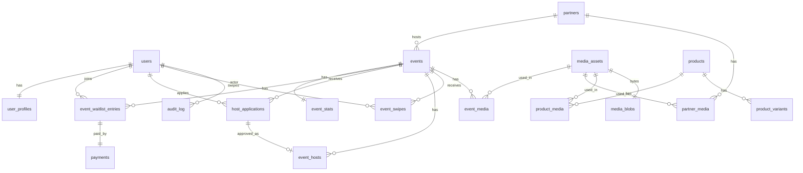

# Events Platform Backend

Node 20+, TypeScript, Express, `pg` with plain SQL (no ORM), zod, multer, sharp. PostgreSQL 16.

## Setup (PowerShell)

```powershell
npm install
Copy-Item .env.example .env        # then edit the password if you like
docker compose up -d               # Postgres 16; loads schema.sql on FIRST start only
npm run seed                       # prints user and event ids for the x-user-id header
npm run dev                        # API on http://localhost:3000
npm test                           # smoke test, uses a separate DB called events_test
```

- If port 5432 is taken, set `DB_PORT=5433` and change the port in `DATABASE_URL` in `.env`.
- To reset the DB completely: `docker compose down -v` then `docker compose up -d`.
- Use `requests.http` (VS Code "REST Client" extension) to walk through every endpoint in order.
  Paste the ids printed by `npm run seed` at the top of that file.
- Audit log (no endpoint, as per the brief):
  `docker exec events_db psql -U events -d events -c "SELECT * FROM audit_log ORDER BY id"`

## Layout

```
src/index.ts        server bootstrap       src/app.ts   express app (used by tests too)
src/db.ts           pg Pool + withTransaction(fn)
src/middleware/     auth stub (x-user-id), errors, validate (zod)
src/routes/         users, partners, events, waitlist, hosts, swipes, media, products, admin
src/storage/        MediaStorage interface + PostgresStorage (swap for S3 later)
src/seed.ts         idempotent seed
tests/smoke.test.ts walkthrough steps 2-6 against events_test
```

Every handler has a comment listing the tables it touches. Errors are always `{ "error": "..." }`
with 400/401/403/404/409. Auth, payments and ranking are stubs (see TODO comments).

## How the tables join



Users relate to events many-to-many through three tables, each with its own status lifecycle:
`event_waitlist_entries` (pending/approved/rejected), `host_applications` (same), `event_swipes` (left/right).

### Endpoint to SQL join

| Endpoint | Join |
|---|---|
| GET /users/:id | `users JOIN user_profiles ON user_id = users.id` |
| GET /partners | `partners` filtered by type/city |
| GET /events | `events LEFT JOIN partners, LEFT JOIN event_media ON is_cover, LEFT JOIN event_stats` |
| GET /events/:id | events + partner + stats, then `event_media`, then `event_hosts JOIN users JOIN user_profiles` |
| POST /events/:id/waitlist | insert `payments`, then `event_waitlist_entries(payment_id)` in one transaction |
| GET /admin/events/:id/waitlist | `event_waitlist_entries JOIN users JOIN user_profiles LEFT JOIN payments` |
| PATCH /admin/waitlist/:id | lock `events` row, count approved `event_waitlist_entries`, update entry, insert `audit_log` |
| GET /hosts/events | `events JOIN event_stats LEFT JOIN partners` where needs_host and future |
| GET /admin/events/:id/host-applications | `host_applications JOIN users JOIN user_profiles` |
| PATCH /admin/host-applications/:id | update `host_applications`, insert `event_hosts`, insert `audit_log` |
| PUT /events/:id/swipe | upsert `event_swipes`; a trigger recomputes `event_stats` |
| GET /events/feed | `events LEFT JOIN event_swipes (this user) ... WHERE s.event_id IS NULL` |
| GET /events/top | `events JOIN event_stats ORDER BY rank_score DESC` |
| POST /events/:id/media | insert `media_assets` + `media_blobs` + `event_media` in one transaction |
| GET /media/:id | `media_assets JOIN media_blobs` (the only query that reads bytes) |
| GET /products | `products` with correlated `json_agg` subqueries over `product_variants` and `product_media` |

## Behaviour notes (choices the brief left open)

- Express 5 is installed. Route order matters: `/events/feed` and `/events/top` are registered before `/events/:id`.
- Reviewing a waitlist entry or host application is allowed only while it is `pending`; otherwise 409.
- A user who is rejected/cancelled cannot re-join the same event (the schema has UNIQUE(event_id, user_id)).
- Swiping, waitlist and host applications require the event to be published (host applications also need `needs_host`).
- Public (no header needed): health, GET /events, /events/:id, /events/top, /partners, /products, /hosts/events, /media/:id, POST /users, GET /users/:id.
  Everything else needs `x-user-id`; admin routes need an admin user.
- GET /events/top does not filter out past events (the brief says published events by rank).

## Known gaps (documented, not fixed)

- Rejecting a waitlisted person does not trigger a refund.
- The schema does not enforce that `reviewed_by` is an admin; the API does.
- `rank_score` in `refresh_event_rank_scores()` is a placeholder formula to tune.
- Personal data (profiles, phone, DOB) is stored; add privacy and retention handling before production.
- GET /users/:id has no ownership check because auth is a stub.

## Out of scope (hooks only)

Real auth (JWT/OAuth), real payments and refunds, merch orders/cart, S3 uploads, notifications, rate limiting, deployment/CI.
